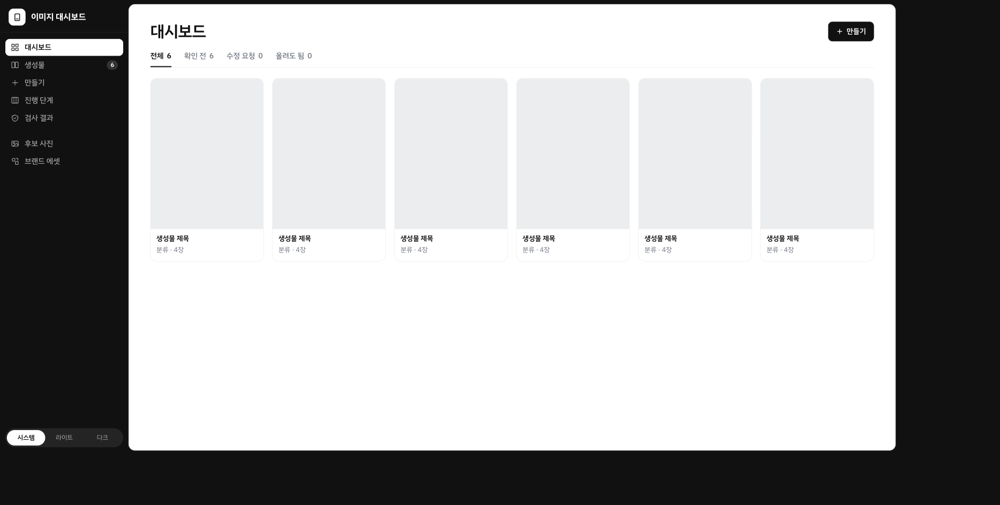

# 이미지 대시보드

이미지 생성물을 대시보드에서 확인하고, 
생성과 이력관리를 동시에 하는 구조니다.
내 컴퓨터(localhost)에서 돌아갑니다. 

## 할 수 있는 일

| 메뉴 | 하는 일 |
|---|---|
| 대시보드 | 생성물을 표지 카드로 한눈에 봅니다. 상태 탭으로 거릅니다. |
| 생성물 | 상태별로 봅니다. 「올려도 됨」과 「수정 요청」을 누릅니다. |
| 만들기 | 만들 것 · 쓰임 · 레퍼런스 주소를 적어 요청을 넣습니다. |
| 진행 단계 | 생성물마다 어느 단계까지 왔는지 표로 봅니다. |
| 검사 결과 | 생성물별 검사 결과를 표로 봅니다. |
| 후보 사진 | 생성물별 후보 사진을 봅니다. |
| 브랜드 에셋 | 로고 · 제품 · 기타 파일을 모아 봅니다. |

생성물을 열면 장별 그림, 수정 메모, 이력을 봅니다.
